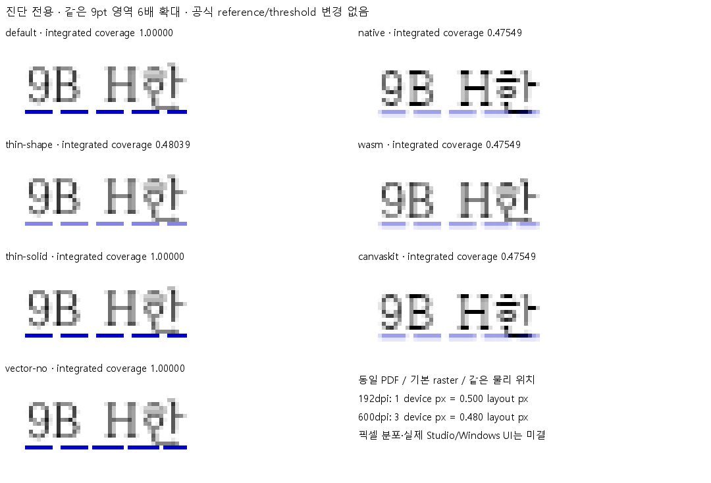

# 9pt 밑줄 잉크 농도의 raster 진단

2026-10-29 읽기 진단. 제품·회귀·원본 입력·공식 reference·DPI·threshold·features.md를 바꾸지 않았다. 대상은 5번 긴 파선의 9pt 첫 획 내부이며 3·4·5번 패턴 기하의 완료한 대조를 다시 수행한 결과가 아니다.
입력은 이전 #8038 합성 프로브 저장본이다. [HWP](https://raw.githubusercontent.com/semanticist21/rhwp/e4b792845f51a21a4f655579a1fc652203fb1dc1/mydocs/pr/assets/raised-decoration-hancom/top-probe-shape-5.hwp)와 [한컴 Print PDF](https://raw.githubusercontent.com/semanticist21/rhwp/e4b792845f51a21a4f655579a1fc652203fb1dc1/pdf/raised-decoration-hancom/top-probe-shape-5-hancom-print.pdf)를 재사용했다. 원본 PDF SHA-256 `f9a1d4e0f2071730269f1f9360ee31d5c13b3d79591761b398581a7c5029da25`; Hwp 2024 13.0.0.4132 / Hancom PDF 1.3.0.550, 실제 header PDF-1.6·metadata PDFVersion 1.4.
PDF p1의 blue stroke는 `RG [0 0 0.8]`, `w 0.36`pt(96dpi 환산 0.48px), `d [[],0]`, butt `J 0`·miter `j 0`·`M 10`이다. `/ExtGState`·`gs`·Form `Do`·page `/Group`이 없고 `/UserUnit`은 1, 회전은 0이다. 파일에 stroke-adjust `/SA`, stroke opacity `/CA` 또는 fill opacity `/ca` 지정은 발견되지 않았다.
제품 산출물은 `e4b792845f51a21a4f655579a1fc652203fb1dc1`의 이미 검증한 actual Native Skia / fresh WASM Canvas2D Print / CanvasKitLayerRenderer software Print PNG를 재사용했다. 새 제품 빌드나 실제 Studio 전체 screen 검증 결과로 표시하지 않는다. [기존 실행 환경·producer 해시·전쪽 검증](../bottom-long-dash-hancom/verification.md).
Poppler pdftoppm 26.07.0의 동일 PDF p1을 96dpi로 재-raster했다. 실행 파일 SHA-256 `7ca29857be967e4a8c57309e65ef2c3fc62c7993e2ea8da64aaff94749a0cd35`. `pdftoppm -f 1 -singlefile -png -r 96 <PDF> <OUT>`에 각 표의 옵션만 추가했다. `default`와 `-thinlinemode solid`의 전체 PNG bytes는 같았고, default RGB 픽셀은 기존 공식 reference와 같았다.
같은 좌표 x=[115,119), y=[160,167)의 첫 획 내부 4열을 측정했다. 흰 배경의 파랑은 `contrast=max(0,B-max(R,G))`; 열당 적분 coverage는 `sum(contrast)/(204*4)`다. 이동·정렬·threshold 처리를 하지 않았다. 아래 마지막 열은 x=116에서 0이 아닌 행별 contrast이며, 적분값이 같아도 공간 분포가 같다는 뜻은 아니다.

| 출력/진단 옵션 | 96dpi layout px 환산 coverage | 대표 열 contrast |
| --- | ---: | --- |
| default | 1.00000 | 204 |
| thin-shape | 0.48039 | 98 |
| thin-solid | 1.00000 | 204 |
| vector-no | 1.00000 | 204 |
| native | 0.47549 | 77 + 20 |
| wasm | 0.47549 | 77 + 20 |
| canvaskit | 0.47549 | 77 + 20 |

동일 물리 위치 x≈117, y≈163.501에서 PDF 기본 raster를 DPI만 바꾸면 96dpi는 1 device px=1.00000 layout px, 192dpi는 1 device px=0.50000 layout px, 600dpi는 3 device px=0.48000 layout px였다. 원본 PDF bytes·stroke 설정은 같다.
실제 소비 코드는 [Native styled_with_phase](https://github.com/semanticist21/rhwp/blob/e4b792845f51a21a4f655579a1fc652203fb1dc1/src/renderer/skia/text_replay/lines.rs)(AA on·전달 width 그대로), [WebCanvas draw_single_canvas_line](https://github.com/semanticist21/rhwp/blob/e4b792845f51a21a4f655579a1fc652203fb1dc1/src/renderer/web_canvas.rs)(set_line_width 그대로), [CanvasKit drawTextVisualStroke/makeStrokePaint](https://github.com/semanticist21/rhwp/blob/e4b792845f51a21a4f655579a1fc652203fb1dc1/rhwp-studio/src/view/canvaskit-renderer.ts)(opacity 기본 1·AA on·max(0.1,width))다. 대상 0.48px에 별도 1px 하한이나 0.48 opacity가 공급된 경로는 확인되지 않았다.
확인한 범위: 9pt의 적분 농도 차이에는 reference raster의 thin-line 처리 영향이 크다. Native/Canvas2D/CanvasKit의 약 0.47549는 PDF 벡터 두께 0.48과 8bit coverage 양자화 범위에 가깝다. 이 관측만으로 제품의 공통 기하를 1px로 키울 근거는 없다. 공식 default reference와 2px raw gate는 그대로 유지한다.
미결: 원위치의 행별 픽셀 분포·작은 점의 모양·다른 크기/글꼴·회전·세로쓰기·겹침·실제 Studio 및 Windows 앱 UI·저장/재열기·앱 인쇄는 해결했다고 판정하지 않는다. `thin-shape`와 DPI 변형은 진단용이며 새로운 정상 기준이나 regression golden으로 등록하지 않는다.
검증: 전체 PDF graphics-state 및 원본/reference 해시·기존 default RGB 동일성·0.48/1.0 coverage·세 제품 PNG의 9pt 적분값 self-check 통과. 문서·최종 비교 PNG만 변경하여 제품·검사·입력 blob이 부모와 같은지 Git tree로 확인한다. Rust/WASM/Studio 검사를 새로 수행했다고 주장하지 않는다.
최종 PR 연결/통합 후 comment에는 이 MD와 아래 PNG를 해당 commit SHA의 raw URL로 사용한다. 중간 PNG·분석 JSON·고 DPI raster·실행 로그는 커밋하지 않는다.

